<div align="center">


<br>

[](#getting-started)
[](https://www.rust-lang.org/)
[](https://github.com/emilk/egui)
[](#bilingual)
[](LICENSE)

**A lightweight, from-scratch take on the "one mixer for game, chat and music" idea.**<br>
Split your PC audio into channels, EQ each one, clean up your mic with a neural network,<br>
and do it all with **~5 MB of RAM** in the background.

[Features](#features) ·
[Benchmark](#benchmark-vs-steelseries-gg) ·
[Screenshots](#screenshots) ·
[How it works](#how-it-works) ·
[Getting started](#getting-started) ·
[REST API](#rest-api) ·
[Español](docs/README.es.md)

<br>

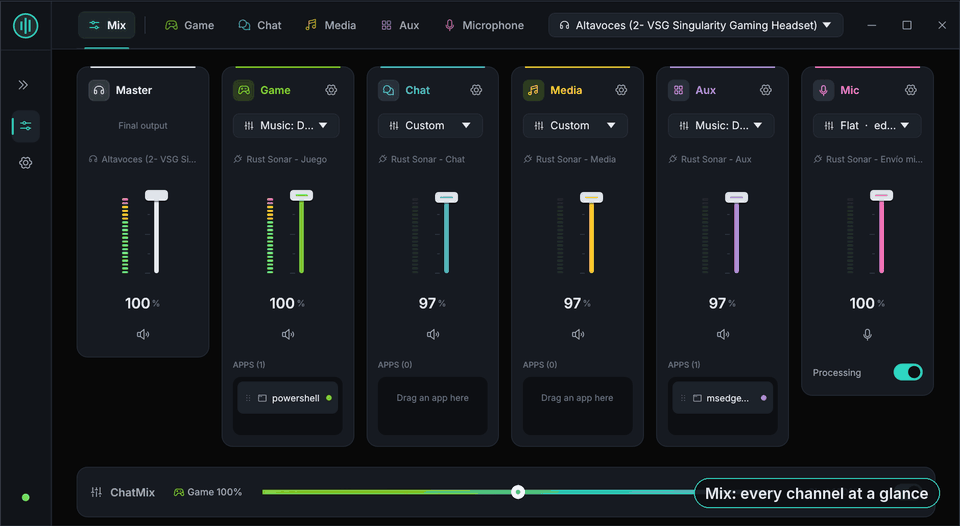

<sub><a href="assets/readme/demo.mp4"> Watch the tour in full quality (MP4)</a></sub>

</div>

---

## <a id="features" href="#features"></a> Features

<table>
<tr>
<td width="50%" valign="top">

### <a id="mixing" href="#mixing"></a> Mixing
- **Four channels** — Game, Chat, Media, Aux — plus a Master and the mic.
- **Real per-app routing.** Moving an app to a channel changes its output in Windows itself, the same thing *App volume and device preferences* does.
- **ChatMix**: one slider to balance game against voice chat.
- **Native volume integration**: each channel *is* a Windows device, so keyboard volume keys and the Windows mixer move the fader, and vice versa.
- **Automatic app sorting** (Discord → Chat, Spotify → Media…), remembered by executable name.

</td>
<td width="50%" valign="top">

### <a id="sound" href="#sound"></a> Sound
- **Parametric EQ** per channel: up to 16 bands (bell, shelves, low/high-pass, notch) on an interactive graph, plus presets and favorites.
- **Smart volume**: a per-channel compressor that lifts footsteps and dialogue and tames explosions.
- **Spatial audio**: 5.1/7.1 placed around your head with a spherical-head model (interaural delay, head shadow, rear filtering).
- **Imports SteelSeries Sonar share links**: 10-band EQ, bass/voice/treble, smart volume, gain and spatial settings. It can export to the same format.

</td>
</tr>
<tr>
<td valign="top">

### <a id="microphone" href="#microphone"></a> Microphone
- **AI noise suppression** with RNNoise (pure-Rust `nnnoiseless`), running locally.
- **Voice-activity gate**, noise gate, EQ, voice compressor and *hear myself*.
- **Virtual microphone**: Discord, OBS or Teams see the processed mic as a normal input.
- **On demand**: the mic is only processed while an app is recording, so Windows' *microphone in use* icon stays off otherwise.

</td>
<td valign="top">

### <a id="desktop" href="#desktop"></a> Desktop
- **Tray-first**: the engine lives in the tray; the window is a separate process that only exists while it's open.
- **Global mute shortcuts** for the mic, all outputs or any channel (Ctrl+Alt+M / Ctrl+Alt+S by default, rebindable in Settings). They work in games and with the window closed.
- **On-screen notice** when something is muted or unmuted: a click-through card over windowed and borderless games, with a configurable corner and duration.
- **One-click setup**: detects the virtual cables, assigns channels, and picks your headphones and mic.
- **Tidy up Windows devices**: renames the virtual devices to *Rust Sonar - Game / Chat / …* and hides the clutter. It can be undone.
- **Custom installer**, start with Windows, single instance, clean uninstall.
- **Local REST API** for Stream Deck, scripts or a web page.

</td>
</tr>
</table>

---

## <a id="benchmark-vs-steelseries-gg" href="#benchmark-vs-steelseries-gg"></a> Benchmark vs SteelSeries GG

Rust Sonar was built to stay out of your way, so both apps were measured on the **same PC** (Ryzen 5 4600G, 12 threads, Windows 11), 45 s per scenario, with the same pink-noise test signal.

<div align="center">
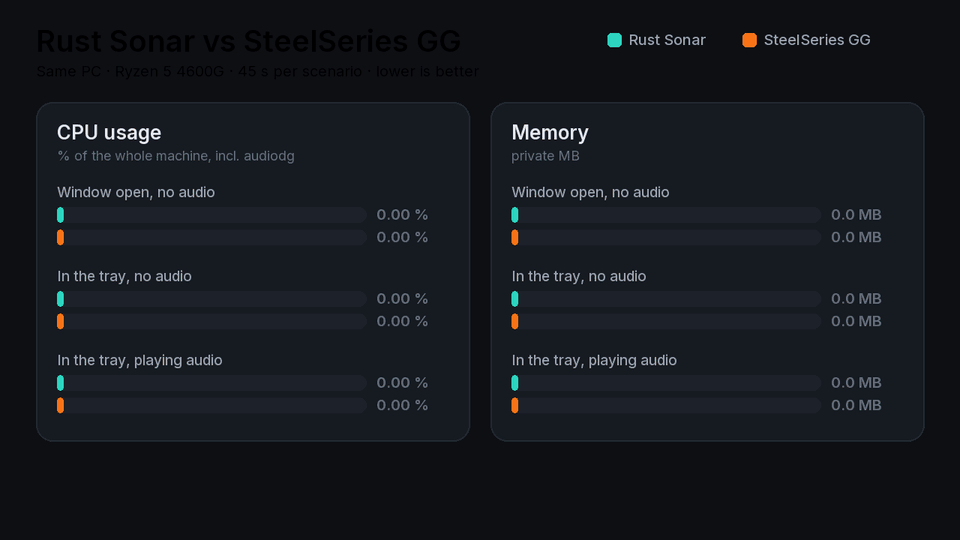

<sub><a href="assets/readme/benchmark.mp4"> Benchmark video (MP4)</a></sub>
</div>

| Scenario | **Rust Sonar** | SteelSeries GG | Difference |
|---|---:|---:|:---:|
| Window open, no audio | **0.15 % CPU · 98 MB** · 2 processes | 0.28 % CPU · 881 MB · 13 processes | **9× less RAM** |
| In the tray, no audio | **0.01 % CPU · 4.8 MB** · 1 process | 0.06 % CPU · 275 MB · 5 processes | **57× less RAM** |
| In the tray, playing audio | **0.26 % CPU · 5.2 MB** | 0.90 % CPU · 273 MB | **3.5× less CPU** |
| Disk space | **24 MB** | 1,338 MB | **56× smaller** |

<sub>CPU = the app's process tree plus its share of <code>audiodg.exe</code>, as % of the whole machine. Memory = private bytes. GG version 123. Both apps had the same 4 channels configured and played the same signal.</sub>

<details>
<summary><b>How does it stay this small?</b></summary>

<br>

| Technique | Effect |
|---|---|
| **Engine and window run as separate processes.** The tray engine never loads a GPU context; the window (`--ui`) syncs with it over the local API and goes away completely when closed. | ~5 MB in the tray instead of ~100 MB |
| **Notifications instead of polling.** Device changes (`IMMNotificationClient`), apps starting or stopping playback (`IAudioSessionNotification` + `IAudioSessionEvents`) and volume changes (`IAudioEndpointVolumeCallback`) wake the threads. Nothing ticks in a loop. | ~0 % CPU when idle |
| **Audio on demand.** A channel only captures while something plays on it (plus 3 s). The output stream is released when there's nothing to mix, so `audiodg` doesn't work for us in silence. | No audio work in silence |
| **Mic on demand.** RNNoise only runs while an app records from the virtual mic, the Mic tab is open, or *hear myself* is on. | No neural network running for nothing |
| **OpenGL (glow) instead of wgpu**, plus adaptive repaint: 30 fps only while meters move, 4 fps otherwise, 0 when minimized. | −220 MB and almost no GPU use |
| **No locks on the audio thread.** Settings are read with `try_read` only when a version counter changes; meters are atomics. | No glitches under load |

</details>

---

## <a id="screenshots" href="#screenshots"></a> Screenshots

<table>
<tr>
<td width="50%">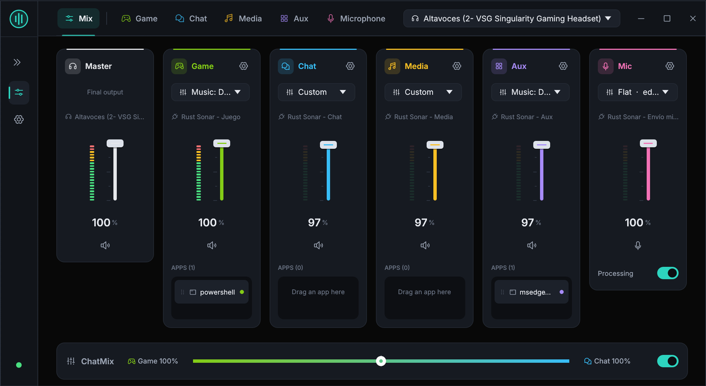<p align="center"><b>Mix</b>: every channel, its apps and ChatMix</p></td>
<td width="50%">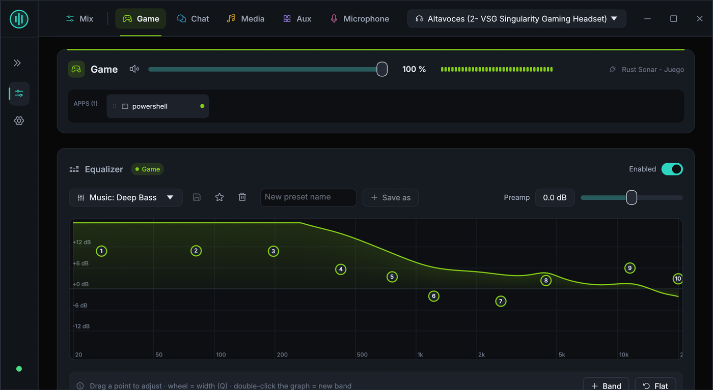<p align="center"><b>Channel</b>: interactive parametric EQ and presets</p></td>
</tr>
<tr>
<td>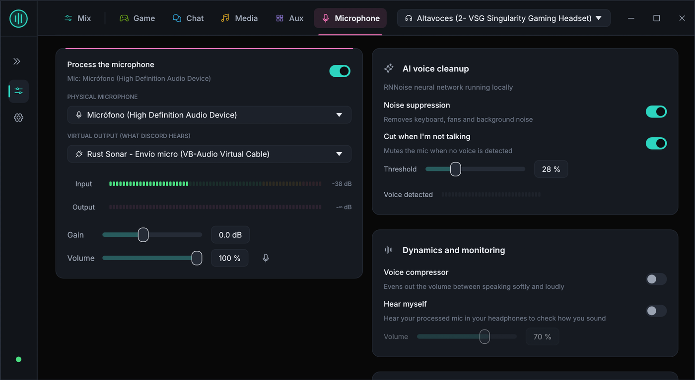<p align="center"><b>Microphone</b>: RNNoise, voice gate, compressor</p></td>
<td>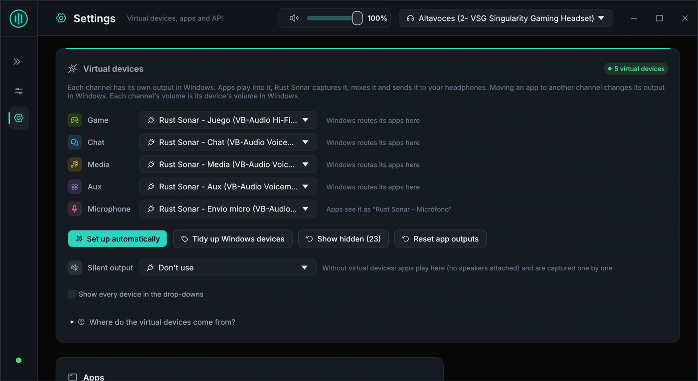<p align="center"><b>Settings</b>: one-click setup of the virtual devices</p></td>
</tr>
</table>

### <a id="bilingual" href="#bilingual"></a> Bilingual

The whole app is available in **English and Spanish**: the window, the tray menu, status messages and errors. By default it follows your Windows display language; you can change it under *Settings → General → Language*.

<div align="center">
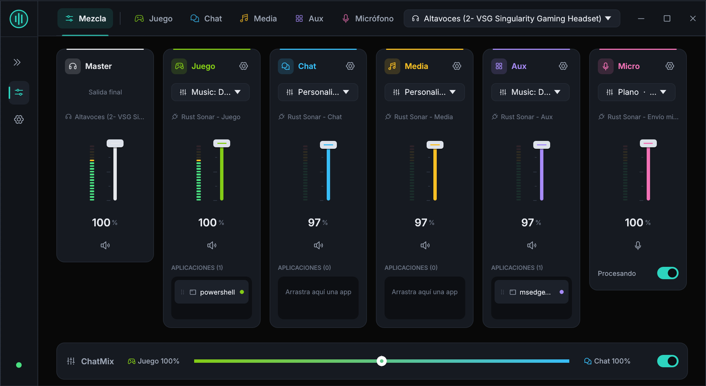
</div>

---

## <a id="how-it-works" href="#how-it-works"></a> How it works

Windows doesn't let a normal program add audio outputs: that needs a kernel driver signed by Microsoft, and unsigned drivers only load in test mode, which anti-cheats like Vanguard block. So Rust Sonar **doesn't ship a driver**. Instead, it drives free, signed virtual cables through the public Windows audio APIs:

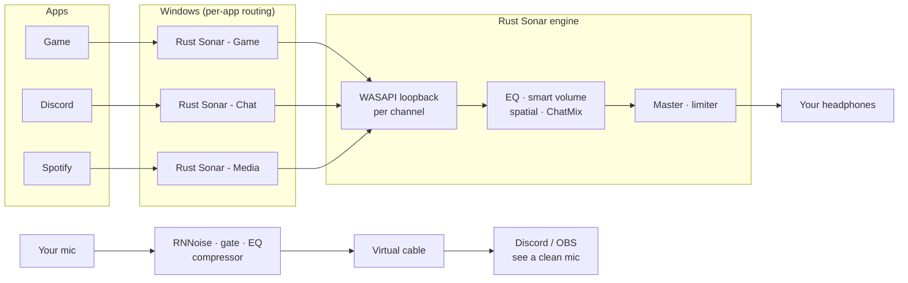

1. **Routing.** When you move an app to a channel, Rust Sonar asks Windows to send that app's audio to the channel's virtual device (`IAudioPolicyConfigFactory`).
2. **Capture.** The engine captures each virtual device in **loopback** with its native channel count, so 7.1 stays 7.1 for spatial audio.
3. **Processing.** Each bus goes through EQ (RBJ biquads), smart volume, spatial audio and gain, then into a Master with a limiter, out to your real headphones.
4. **Clock drift.** Every input has a jitter buffer that resamples by up to ±0.3 % (cubic interpolation) to follow the device clocks, instead of dropping or inventing blocks.
5. **Fallback mode, no drivers.** Channels without a virtual device capture each app separately with WASAPI *process loopback* (Windows 10 2004+).

<details>
<summary><b>Process and thread architecture</b></summary>

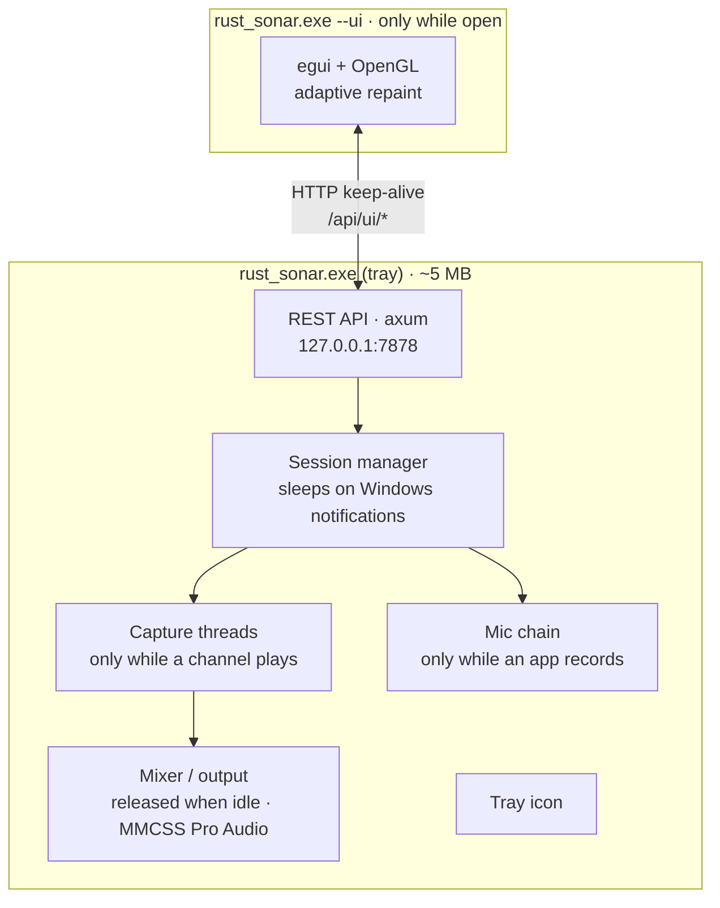

</details>

---

## <a id="getting-started" href="#getting-started"></a> Getting started

### Quick install

Download **`RustSonar-Instalador-<version>.exe`** from the [latest release](https://github.com/kilorito2/rust-sonar/releases/latest) and run it. It installs Rust Sonar and the VB-Audio virtual cables you're missing (downloaded from vb-audio.com during setup), then asks you to restart. The steps below are for building it yourself.

### 1. Virtual devices

Rust Sonar uses free, signed virtual cables from **[VB-Audio](https://vb-audio.com/Cable/)**. For the full experience (4 channels plus a virtual mic), install as administrator and restart:

| Driver | Provides |
|---|---|
| [VB-CABLE](https://vb-audio.com/Cable/) | Virtual microphone cable |
| [Hi-Fi Cable](https://vb-audio.com/Cable/) | One channel output |
| [Voicemeeter Potato](https://vb-audio.com/Voicemeeter/potato.htm) | Additional channel outputs (VAIO / AUX / VAIO3) |

> With fewer cables, it still works: channels without a device fall back to per-app capture.
> With none at all, you can pick a **silent output** (for example an unused motherboard jack): apps play there inaudibly and Rust Sonar mixes them into your headphones.

### 2. Build and run

```powershell
git clone https://github.com/kilorito2/rust-sonar.git
cd rust-sonar
cargo run --release
```

Requires Rust 1.85+ (edition 2024) and Windows 10 2004+ / Windows 11.

### 3. First launch

1. Close SteelSeries GG if it's running. Both would mix the same devices, so Rust Sonar pauses while GG is open.
2. Go to **Settings → Virtual devices → Set up automatically**.
3. Optionally, press **Tidy up Windows devices** so Windows and Discord only list your real devices and *Rust Sonar - …*.
4. In Discord, set the input device to **Default**, or to *Rust Sonar - Microphone*.

The X hides the window to the tray (configurable). To quit, right-click the tray icon → **Quit**. Your Windows default devices are restored when it quits.

### Building the installer (optional)

`powershell -ExecutionPolicy Bypass -File installer\build.ps1` builds a signed release and a custom installer: a Rust/egui front end around Inno Setup that shows live progress, detects upgrades and installs the missing VB-Audio drivers. Like the app, it's in English and Spanish.

<div align="center">
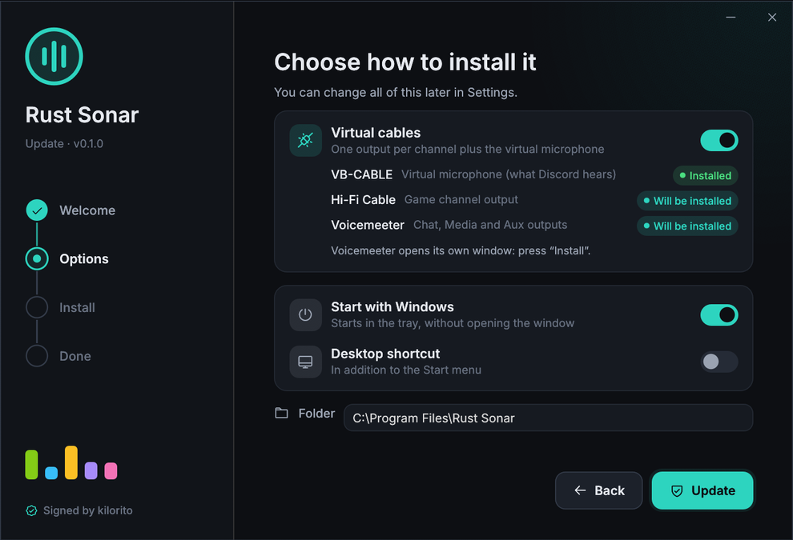
</div>

> [!NOTE]
> The VB-Audio license does not allow bundling their drivers inside another program's installer, so the installer doesn't carry them: it downloads the official packages from `download.vb-audio.com` during setup (only the missing ones) and checks their SHA-256 before running them. That's why it needs an Internet connection, and why it can be shared.

---

## <a id="rest-api" href="#rest-api"></a> REST API

The engine listens on `127.0.0.1:7878` (configurable). It's handy for Stream Deck buttons, scripts or a web remote.

```http
GET    /api/state                                 full state + meters
GET    /api/devices | /api/apps
PATCH  /api/channels/{game|chat|media|aux}        {"volume":0.5,"muted":false}
PUT    /api/channels/{ch}/eq                      full EqSettings
POST   /api/channels/{ch}/eq/preset/{name}
PATCH  /api/master                                {"volume":0.8}
PUT    /api/chatmix                               {"value":-0.3,"enabled":true}
PUT    /api/apps/{exe}                            {"channel":"chat"}
PATCH  /api/mic                                   {"muted":true,"noise_suppression":true}
POST   /api/import                                {"link":"<Sonar share link>","channel":"game"}
GET    /api/channels/{ch}/export                  settings in Sonar's format
POST   /api/setup                                 one-click setup
POST   /api/devices/tidy | /api/devices/show-hidden
POST   /api/quit                                  clean shutdown
```

```powershell
# Mute the mic from anywhere
Invoke-RestMethod -Method Patch http://127.0.0.1:7878/api/mic -ContentType application/json -Body '{"muted":true}'
```

---

## <a id="project-structure" href="#project-structure"></a> Project structure

```
src/
├── main.rs              entry point: engine (tray), --ui window, admin helpers
├── i18n.rs              English / Spanish (tr! / trf! macros, follows the Windows language)
├── config.rs            settings model and JSON persistence (%APPDATA%\RustSonar)
├── state.rs             shared state: RwLock + atomics, wakers
├── api.rs               REST API (axum, single-threaded tokio)
├── system.rs            single instance, autostart, window helpers
├── tray.rs              Win32 tray icon
├── hotkeys.rs           keys allowed in shortcuts (name ↔ virtual key ↔ egui key)
├── overlay.rs           global shortcuts (RegisterHotKey) and the on-screen mute notice
├── virtual_devices.rs   detection, one-click setup, device tidy-up and uninstall cleanup
├── sonar_import.rs      SteelSeries Sonar share-link import/export
├── audio/
│   ├── wasapi.rs        COM/WASAPI wrappers: devices, sessions, capture, render, volume
│   ├── notify.rs        Windows notifications → wakers (no polling)
│   ├── engine.rs        routing, on-demand capture, mixer, defaults
│   ├── routing.rs       per-app output, default devices, rename/hide endpoints
│   ├── fifo.rs          jitter buffer with adaptive resampling
│   └── mic.rs           microphone chain
├── dsp/                 biquads, EQ, compressor, gate, reverb, spatial (5.1/7.1 → binaural)
└── ui/                  egui views: mixer, channel, mic, settings, EQ editor, widgets
installer/               Inno Setup script, custom egui installer, signing scripts
docs/                    notes, Spanish README, media generator
```

```powershell
cargo test                                      # 59 unit tests
cargo test --release -- --ignored --nocapture   # probes against real hardware
```

---

## <a id="known-limitations" href="#known-limitations"></a> Known limitations

- **Depends on third-party virtual devices.** No custom driver, for the reasons above.
- `IAudioPolicyConfigFactory` and `IPolicyConfig` are undocumented Windows interfaces. If a Windows update changes them, per-app routing fails with a visible error (it doesn't crash), and you can keep using per-app capture.
- Spatial audio uses a spherical-head model, not measured HRTFs. Left/right and front/back cues are good; elevation isn't modelled.
- The engine wakes about 0.5 s after a channel starts playing, so the very first moment of a sound can be missed.
- If the process is force-killed, Windows defaults stay on the virtual devices until Rust Sonar is opened and closed again.

---

## <a id="disclaimer" href="#disclaimer"></a> Disclaimer

Rust Sonar is an independent student project. It is **not affiliated with, endorsed by, or connected to SteelSeries**. "SteelSeries", "SteelSeries GG" and "Sonar" are trademarks of their respective owners and are used here only to describe compatibility and for comparison. No SteelSeries code, assets or text are included. The interface and engine were written from scratch. VB-CABLE, Hi-Fi Cable and Voicemeeter are products of VB-Audio Software.

## <a id="license" href="#license"></a> License

[MIT](LICENSE) © kilorito. The VB-Audio drivers are not included and keep their own license.

## <a id="credits" href="#credits"></a> Credits

[egui / eframe](https://github.com/emilk/egui) ·
[windows-rs](https://github.com/microsoft/windows-rs) ·
[nnnoiseless](https://github.com/jneem/nnnoiseless) (RNNoise port) ·
[axum](https://github.com/tokio-rs/axum) ·
[Inter](https://rsms.me/inter/) (OFL) ·
[Phosphor Icons](https://phosphoricons.com/) (MIT) ·
[VB-Audio](https://vb-audio.com/) virtual cables

<div align="center">
<sub>Made with <a href="#credits"></a> and Rust by <b>kilorito</b></sub>
</div>
