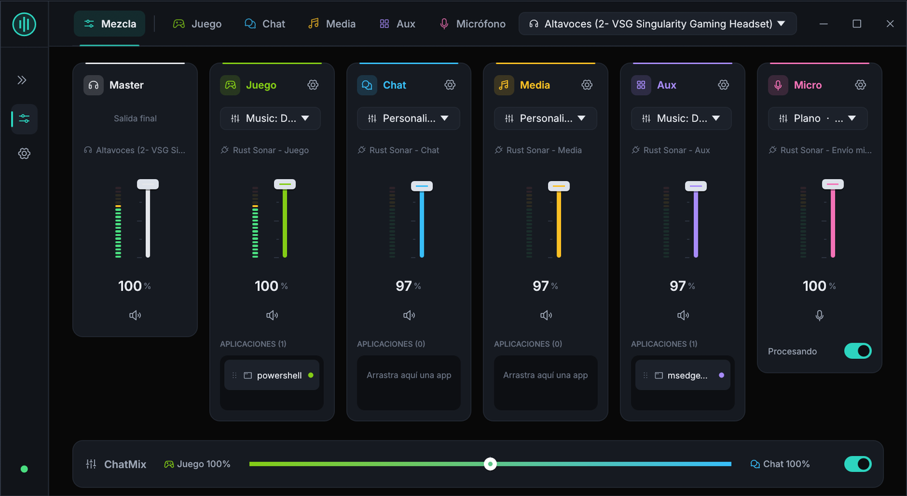
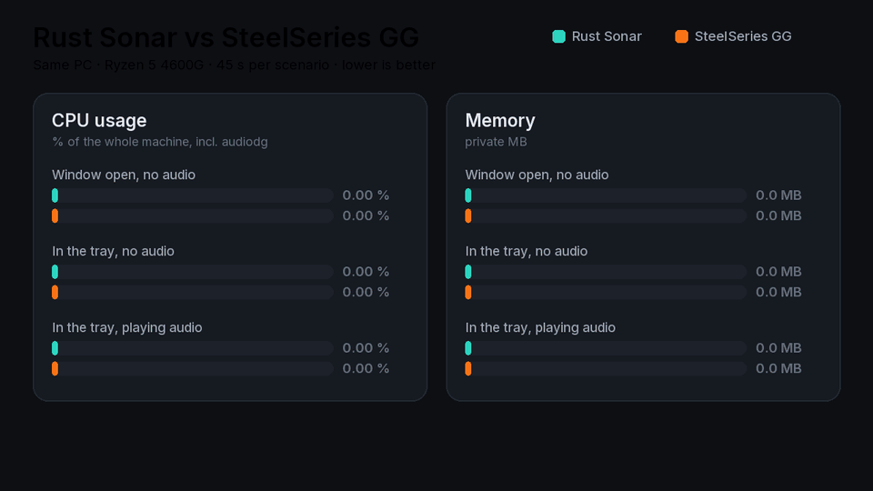

<div align="center">


**Mezclador de audio por canales para Windows, escrito en Rust.**<br>
[English](../README.md) · Español



</div>

Rust Sonar está inspirado en la *idea* de SteelSeries Sonar: canales Juego/Chat/Media/Aux, ChatMix,
ecualizador paramétrico y micrófono con limpieza de voz por IA. Es una implementación propia desde
cero, que no contiene ni traduce código de SteelSeries. Toda la interfaz está en **español e
inglés**: sigue el idioma de Windows y se puede cambiar en *Ajustes → General → Idioma*.

## <a id="funciones" href="#funciones"></a> Funciones

| Función | Cómo está hecha |
|---|---|
| Salidas virtuales por canal | Usa dispositivos de audio virtuales firmados (VB-CABLE, Hi-Fi Cable, Voicemeeter). El motor captura cada uno en loopback con sus canales nativos y los mezcla. |
| Configuración en un clic | «Configurar automáticamente» reparte los dispositivos virtuales, elige auriculares y micro reales y activa el micro virtual. |
| Enrutado real por app | Al mover una app de canal, Windows cambia su salida (`IAudioPolicyConfigFactory`, la misma API que *Volumen de aplicaciones y preferencias de dispositivos*). Al cerrar se deshace. |
| Volumen integrado con Windows | El volumen de un canal es el de su dispositivo en Windows: las teclas de volumen y el mezclador de Windows mueven el fader, y al revés. |
| Audio espacial | El 5.1/7.1 del dispositivo virtual se coloca alrededor de la cabeza con un modelo de cabeza esférica (Brown y Duda). |
| Volumen inteligente y refuerzo | Compresor por canal (sube lo flojo, contiene lo fuerte) y hasta ±12 dB. |
| Micrófono con IA | RNNoise (`nnnoiseless`), puerta por voz, puerta de ruido, EQ, compresor de voz y escucha propia. Solo se procesa mientras alguna app graba. |
| Modo sin drivers | Los canales sin dispositivo virtual capturan cada app por separado (WASAPI *process loopback*). |
| Ecualizador paramétrico | Hasta 16 bandas por canal, presets y favoritos, curva de respuesta interactiva. |
| Configuraciones de Sonar | Importa y exporta los enlaces de compartir de SteelSeries Sonar. |
| Escritorio | Bandeja del sistema, inicio con Windows, instancia única, instalador propio. |
| Atajos de teclado | Globales (`RegisterHotKey`) para silenciar el micro, todas las salidas o cada canal; por defecto Ctrl+Alt+M y Ctrl+Alt+S, se cambian en Ajustes. Funcionan en juegos y con la ventana cerrada. |
| Aviso en pantalla | Al silenciar o activar algo aparece una tarjeta encima de todo (juegos en ventana o sin bordes), transparente al ratón; esquina y duración configurables. |
| API REST | `axum` en `127.0.0.1:7878` (Stream Deck, scripts, web). |
| Idiomas | Español e inglés (`src/i18n.rs`, macros `tr!` y `trf!`). |

## <a id="consumo" href="#consumo"></a> Consumo

Motor y ventana van en procesos separados, los hilos duermen hasta que Windows avisa de algo y el
audio (canales, salida y micro) solo se procesa cuando hace falta. Detalles en el
[README en inglés](../README.md#-benchmark-vs-steelseries-gg).



| Escenario | Rust Sonar | SteelSeries GG 123 |
|---|---|---|
| Ventana abierta, sin audio | **0,15 %** · 98 MB · 2 procesos | 0,28 % · 881 MB · 13 procesos |
| En la bandeja, sin audio | **0,01 %** · **4,8 MB** · 1 proceso | 0,06 % · 275 MB · 5 procesos |
| En la bandeja, con audio | **0,26 %** · **5,2 MB** | 0,90 % · 273 MB |
| Espacio en disco | **24 MB** | 1.338 MB |

Medido en un Ryzen 5 4600G (12 hilos), 45 s por escenario. CPU = proceso + `audiodg`, en % del equipo.

## <a id="dispositivos-virtuales" href="#dispositivos-virtuales"></a> Dispositivos virtuales

Rust Sonar no instala un driver propio: un driver de kernel sin firma de Microsoft solo funciona
con Windows en modo de prueba, que bloquea anti-cheats como Vanguard. Usa dispositivos virtuales
ya firmados y gratuitos de [vb-audio.com](https://vb-audio.com/Cable/):

- **VB-CABLE** (micrófono virtual), **Hi-Fi Cable** y **Voicemeeter Potato** (salidas de canal).
  Se instalan como administrador y hay que reiniciar. Después, «Configurar automáticamente» y,
  si quieres, «Ordenar dispositivos de Windows», que los renombra («Rust Sonar - Juego»,
  «- Chat»…) y oculta los sobrantes. «Mostrar los ocultos» lo deshace.
- Los dispositivos de **SteelSeries GG** solo existen con GG abierto, y entonces Rust Sonar se
  pone en pausa para no duplicar el audio.
- **Sin ningún dispositivo virtual**: elige una «salida silenciosa» (una salida real que no
  escuches). Las apps suenan ahí y Rust Sonar las captura una a una y las mezcla en tus auriculares.

## <a id="uso" href="#uso"></a> Uso

```powershell
cargo run --release
cargo test
cargo test --release -- --ignored --nocapture   # sondas contra el hardware real
```

1. Cierra SteelSeries GG si lo tienes abierto.
2. *Ajustes → Dispositivos virtuales → Configurar automáticamente*.
3. En Discord deja el micrófono en «Default» o elige «Rust Sonar - Micrófono».

## <a id="instalador" href="#instalador"></a> Instalador

`powershell -ExecutionPolicy Bypass -File installer\build.ps1` genera un instalador propio (Rust +
egui por fuera, Inno Setup por dentro) que puede instalar también los drivers de VB-Audio.

> **Solo para uso personal.** La licencia de VB-Audio no permite integrar sus paquetes en el
> instalador de otro programa sin permiso del autor. Los drivers no están en el repositorio
> (`instaladores/` está en `.gitignore`). Para distribuir Rust Sonar hay que quitar la tarea
> `drivers` de `installer/RustSonar.iss` o pedir permiso a VB-Audio.

## <a id="limitaciones-conocidas" href="#limitaciones-conocidas"></a> Limitaciones conocidas

- Depende de dispositivos virtuales de terceros.
- `IAudioPolicyConfigFactory` e `IPolicyConfig` no están documentadas: si Windows las cambia, el
  enrutado por app falla con un error visible y se puede seguir con la captura por aplicación.
- El audio espacial usa un modelo de cabeza esférica, no HRTF medidas (sin elevación).
- El motor despierta unos 0,5 s después de que un canal empiece a sonar.
- Si el proceso se mata a la fuerza, los predeterminados de Windows se quedan en los dispositivos
  virtuales hasta volver a abrir y cerrar Rust Sonar.

---

Licencia [MIT](../LICENSE). Proyecto universitario independiente, sin relación con SteelSeries. «SteelSeries», «GG» y «Sonar»
son marcas de sus propietarios y solo se mencionan para describir la compatibilidad y comparar.
